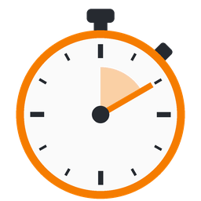

# Stopwatch

A small stopwatch whose window always stays on top, controlled by **global hotkeys**
that work even when the window does not have focus. Available for Linux, macOS
and Windows as a single self-contained binary.



## Features

- Always-on-top timer window (`HH:MM:SS.cc` in Fira Code)
- The whole window content scales when the window is resized; the aspect ratio is locked
- Actions **Start / Stop**, **Pause**, **Resume** and **Reset**, as buttons and as global hotkeys
- **Recent measurements** window: every finished measurement is saved with date and time;
  single entries or all entries can be deleted
- Settings window:
  - record a hotkey for each action (click the field, press the key combination, `Esc` cancels)
  - color scheme: follow system / light / dark
  - language: follow system / German / English
- Settings, history, window position and size are saved permanently

## Installation

Download the file for your system from the
[latest release](https://github.com/dlehmann/stopwatch/releases/latest).
Replace `X.Y.Z` below with the version you downloaded.

### Arch Linux

```bash
sudo pacman -U stopwatch-X.Y.Z-1-x86_64.pkg.tar.zst
```

### Debian / Ubuntu

```bash
sudo apt install ./stopwatch_X.Y.Z-1_amd64.deb
```

### Linux AppImage (any distribution)

```bash
chmod +x Stopwatch-X.Y.Z-x86_64.AppImage
./Stopwatch-X.Y.Z-x86_64.AppImage
```

### Linux binary (any distribution)

```bash
tar xzf stopwatch-X.Y.Z-linux-x86_64.tar.gz
./stopwatch-X.Y.Z-linux-x86_64/stopwatch
```

To install it for your user, copy `stopwatch` to `~/.local/bin/`.

### macOS (Apple Silicon and Intel)

```bash
tar xzf stopwatch-X.Y.Z-macos-universal.tar.gz
cd stopwatch-X.Y.Z-macos-universal
xattr -d com.apple.quarantine stopwatch   # the binary is not signed
./stopwatch
```

### Windows

Run `stopwatch-X.Y.Z-windows-x86_64.exe`. The binary is not signed, so Windows SmartScreen
may ask for confirmation (*More info* → *Run anyway*). No installation is needed.

### Build from source

Requires a recent stable Rust toolchain (<https://rustup.rs>).

```bash
cargo build --release
```

The binary ends up in `target/release/stopwatch` (`stopwatch.exe` on Windows).
It links only against the system C library; on Linux, X11 and OpenGL are loaded at runtime.

## Usage

### Stopwatch states

| Action       | Ready      | Running    | Paused     | Stopped          |
|--------------|------------|------------|------------|------------------|
| Start / Stop | start      | stop       | stop       | restart from 0   |
| Pause        | –          | pause      | –          | –                |
| Resume       | –          | –          | resume     | –                |
| Reset        | –          | reset to 0 | reset to 0 | reset to 0       |

A measurement is added to the history when it ends: on stop, or on reset while running or paused.

Default hotkeys: `Ctrl+Shift+F9` (start/stop), `Ctrl+Shift+F10` (pause),
`Ctrl+Shift+F11` (resume), `Ctrl+Shift+F12` (reset).
Pause and resume may share the same hotkey; it then toggles between pausing and resuming.
While the settings window is open, the global hotkeys are disabled.

### Files

| System  | Settings and history                                   |
|---------|--------------------------------------------------------|
| Linux   | `~/.config/stopwatch/`                                 |
| macOS   | `~/Library/Application Support/stopwatch/`             |
| Windows | `%APPDATA%\stopwatch\config\`                          |

## Platform notes

| Platform                 | Global hotkeys                              | Always on top | Locked aspect ratio |
|--------------------------|---------------------------------------------|---------------|---------------------|
| Windows                  | `RegisterHotKey`                            | yes           | yes                 |
| macOS                    | Carbon hot keys (no permission prompt)      | yes           | yes                 |
| Linux, KDE Plasma        | KGlobalAccel via D-Bus (X11 and Wayland)    | yes           | yes                 |
| Linux, other X11 desktop | X11 key grabs                               | yes           | yes                 |
| Linux, GNOME on Wayland  | only while an X11/XWayland window has focus | yes           | yes                 |

On Linux the window always uses X11 (XWayland on Wayland sessions), because Wayland
does not let applications keep their window on top. The "follow system" color scheme
is read from the XDG desktop portal.

## Releases

GitHub Actions ([release.yml](.github/workflows/release.yml)) builds and packages all
targets on every push. Pushing a tag `vX.Y.Z` that matches the version in `Cargo.toml`
publishes a release with the Arch package, Debian package, AppImage, Linux binary,
macOS universal binary, Windows executable and SHA-256 checksums.

```bash
git tag v1.0.0
git push origin v1.0.0
```

## License

MIT, see [LICENSE](LICENSE). The bundled Fira Code font is licensed under the
SIL Open Font License 1.1, see [assets/fonts/FiraCode-LICENSE.txt](assets/fonts/FiraCode-LICENSE.txt).
